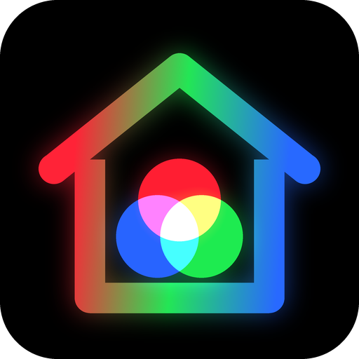
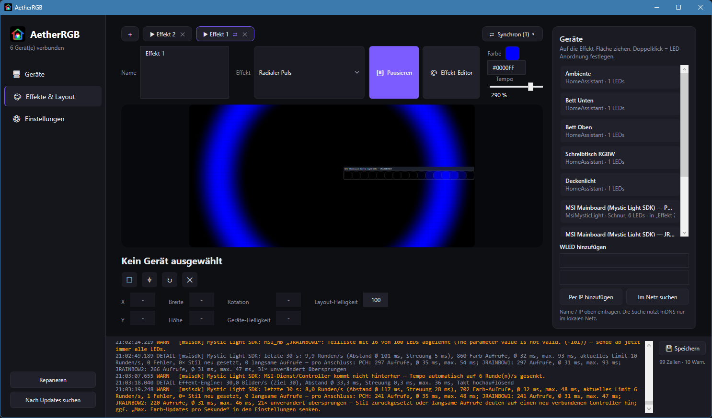
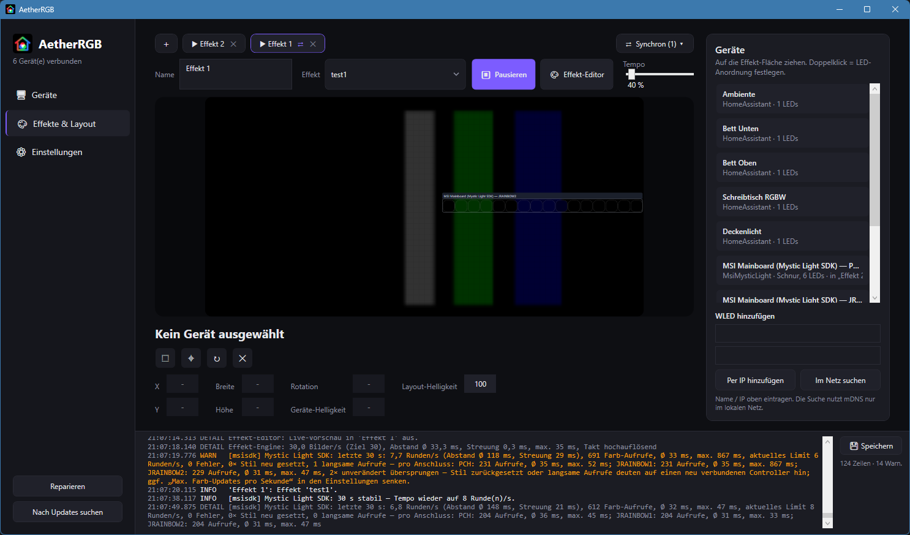
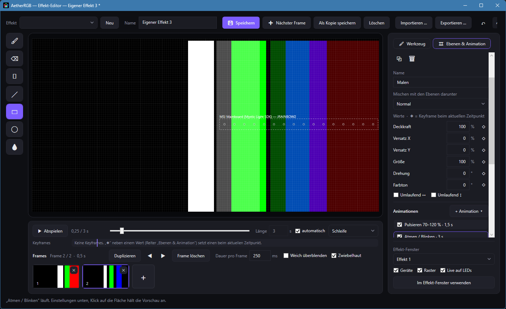
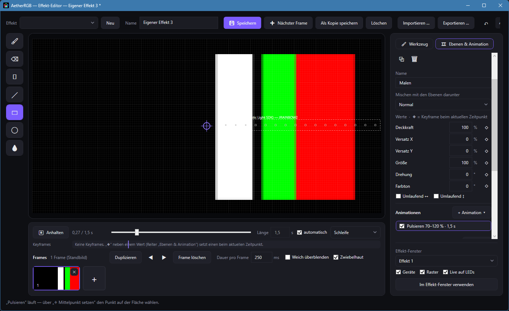
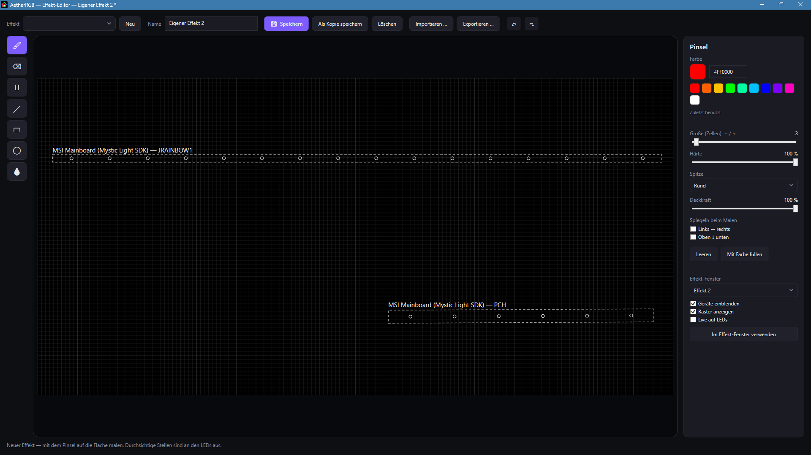
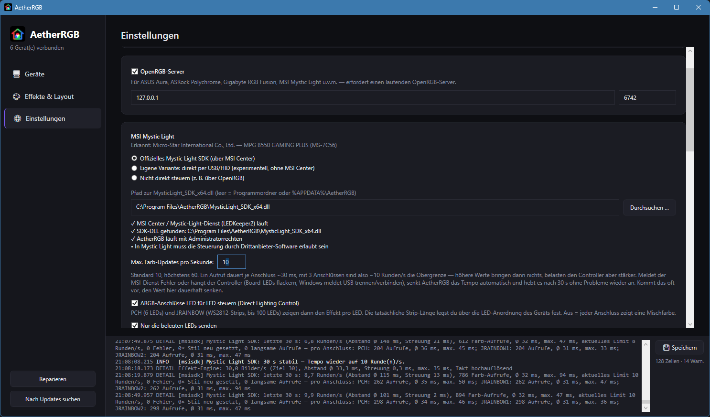

# AetherRGB

Lokale, Cloud-freie RGB-Sync-Software für Windows — ähnlich wie SignalRGB oder OpenRGB, aber mit
offener API, Home-Assistant-Anbindung und WLED-Unterstützung, komplett ohne Account, Lizenzserver
oder Telemetrie.

## Screenshots

**Effekte & Layout**: Geräte auf die Effekt-Fläche ziehen, mehrere Effekt-Fenster als Tabs,
Farben und Tempo pro Effekt, rechts die gefundenen Geräte (Home Assistant, MSI, WLED …).





**Effekt-Editor**: eigene Effekte malen (Pinsel, Formen, Füllen, Spiegeln), mit Frame-Zeitleiste,
Ebenen, Animations-Vorlagen und Keyframes. Die platzierten Geräte liegen zur Orientierung darüber.







**Einstellungen**: z. B. MSI Mystic Light über das offizielle SDK mit Statusprüfung und Tempo-Grenze.



## Kernprinzipien

- **Keine Cloud.** Keine Server-Kommunikation nach außen — alles läuft lokal auf dem PC. Die
  einzige externe Verbindung ist die optionale, manuell ausgelöste Update-Prüfung gegen die
  öffentliche GitHub-Releases-API (kein eigener Update-Server, kein Tracking).
- **Offene lokale REST-API** (`http://127.0.0.1:<Port>/api/...`), bindet ausschließlich an
  `127.0.0.1` — für eigene Skripte, Spiele-Mods oder Dashboards.
- **Home Assistant**: eigene Lichter aus HA als Sync-Quelle einbinden, und/oder HA-Lichter direkt
  wie ein RGB-Gerät mitsteuern — alles über die lokale HA-REST-API mit einem selbst erzeugten
  Long-Lived-Access-Token, kein Nabu-Casa-Cloud-Umweg. HA-Lichter bekommen höchstens alle 3 s
  (einstellbar, nicht weniger) einen Befehl mit dem Mittelwert der Effektfarben, optional mit weichem
  Übergang (`transition`).
- **WLED**: Effekte per [UDP-Echtzeit](https://kno.wled.ge/interfaces/udp-realtime/) (DRGB, ab 491 LEDs
  DNRGB), Geräteinfos über die [WLED-JSON-API](https://kno.wled.ge/interfaces/json-api/). In WLED muss
  „Receive UDP realtime“ aktiv sein (Standard); alternativ in den Einstellungen auf JSON-API umstellen.
- **Motherboard-ARGB** (ASUS Aura Sync, ASRock Polychrome, Gigabyte RGB Fusion, MSI Mystic Light):
  über das [OpenRGB](https://openrgb.org/)-SDK-Protokoll (TCP, Port 6742). AetherRGB implementiert
  bewusst **keine eigenen** SMBus/I2C-Low-Level-Treiber — OpenRGB deckt diese Boards bereits
  geprüft ab, ein Nachbau ohne echte Testhardware birgt ein unnötiges Risiko für die Hardware.
  Voraussetzung: OpenRGB ist installiert und läuft (mit aktiviertem SDK-Server).
- **MSI Mystic Light**: bei erkanntem MSI-Mainboard fragt AetherRGB beim Start, welcher Weg genutzt
  werden soll (jederzeit änderbar unter Einstellungen → MSI Mystic Light):
  - **Offizielles MSI Mystic Light SDK**: AetherRGB meldet sich als Drittanbieter-Client beim
    MSI-Center-Dienst (LEDKeeper2) an, also kein Konflikt mit MSI Center. Voraussetzungen:
    MSI Center mit Mystic-Light-Modul läuft, Drittanbieter-Steuerung ist in Mystic Light erlaubt,
    AetherRGB läuft als Administrator. Die `MysticLight_SDK_x64.dll` wird wegen der MSI-Lizenz
    **nicht mitgeliefert**: Lade das SDK bei MSI herunter und lege die DLL in den Programmordner,
    nach `%APPDATA%\AetherRGB` oder gib den Pfad in den Einstellungen an. ARGB-Anschlüsse
    (PCH, JRAINBOW bis 100 LEDs) werden über „Direct Lighting Control“ LED für LED gesteuert,
    12-V-RGB (JRGB) mit einer Farbe. Die Bildrate ist begrenzt (Standard 10 Updates/s, einstellbar bis 60, bei Problemen automatisch niedriger),
    weil zu schnelle Aufrufe den Board-Controller zum Absturz bringen. Ein Aufruf dauert je Anschluss ~30 ms;
    die Farben werden erst unmittelbar vor jedem Aufruf berechnet, damit die Bewegung trotz niedriger Rate
    gleichmäßig bleibt. Belegt die LED-Anordnung nur einen Teil eines JRAINBOW-Headers, werden nur diese LEDs gesendet.
  - **Eigene Variante (direkt per USB/HID)**: ohne MSI Center und ohne DLL, experimentell
    (vorher MSI Center beenden und den sicheren Einzel-LED-Test machen).

- **Eigene Effekte** (im Aufbau): `.aeffect`-Dateien in `%APPDATA%\AetherRGB\effects` erscheinen
  automatisch in der Effekt-Auswahl. Ein Effekt besteht aus Ebenen (gemalt, auch als Daumenkino, oder
  Formen wie Kreis/Ring/Rechteck), deren Position, Größe, Drehung, Deckkraft und Farbton über Keyframes
  animiert werden.
- **Effekt-Editor** (Knopf „🎨 Effekt-Editor“ auf der Effekte-Seite, eigenes Fenster): auf das Raster
  des Effekt-Fensters (160 × 80 Zellen) malen — Pinsel (Größe 1–50 Zellen, Härte, Deckkraft, rund/eckig,
  Spiegeln), Radierer, Füllen, Linie, Rechteck, Ellipse, Pipette, Rückgängig/Wiederholen. Die Geräte des
  gewählten Effekt-Fensters liegen zur Orientierung darüber, „Live auf LEDs“ zeigt das Gemalte sofort an
  den echten LEDs. Speichern, Kopie, Löschen, Import/Export als `.aeffect`. Durchsichtig = LED aus.
  Tastatur: B/E/G/L/R/O/I = Werkzeuge, +/− = Pinselgröße, Strg+Z/Y, Strg+S, Alt+Klick = Pipette,
  Rechtsklick = radieren, Shift = gerade Linie/Quadrat/Kreis, Esc = Strich abbrechen.
  **Frames:** „➕ Nächster Frame“ (N, mit Shift als Kopie) legt hinter dem aktuellen Frame einen neuen an.
  Die Zeitleiste unter der Fläche zeigt alle Frames als Miniaturen — Klick lädt einen Frame in die Fläche,
  ✕ löscht ihn. Dazu Duplizieren (Strg+D), Verschieben, Dauer pro Frame (ms), weiches Überblenden,
  Zwiebelhaut (voriger Frame scheint durch), Abspielen im Editor und ←/→ zum Blättern.
  **Ebenen & Animation** (zweiter Reiter rechts): mehrere Ebenen — Mal-Ebenen und Formen (Kreis, Ring,
  Rechteck) — mit Sichtbarkeit, Reihenfolge, Duplizieren und Mischmodus (Normal, Addieren,
  Multiplizieren, Aufhellen). **Animations-Vorlagen** pro Ebene, beliebig kombinierbar: Wandern nach
  rechts/links/oben/unten/diagonal oder im freien Winkel (umlaufend oder nicht), Ausdehnender Kreis
  (auch als mehrere Wellen, blendet aus), Zusammenziehen, Pulsieren, Drehen, Atmen, Blinken, Farbe
  wechseln — jeweils mit Dauer, Versatz/Verzögerung, Schleife/Hin und zurück/Einmal und Verlauf.
  „+ Form → Kreis-Welle“ legt einen Ring an, der sich vom angeklickten Punkt ausdehnt. Formen lassen sich
  auf der Fläche verschieben, Mittelpunkte per Klick setzen.
  **Keyframes:** Alle Werte einer Ebene (Versatz, Größe, Drehung, Deckkraft, Farbton, Mitte, Radius …)
  bekommen per „◆“ einen Keyframe am aktuellen Zeitpunkt; danach legt jede Änderung an einem anderen
  Zeitpunkt einen weiteren an. Die Zeitleiste zeigt sie als Rauten (ziehen = verschieben, Rechtsklick =
  Verlauf/Löschen, Entf = löschen). Zeit-Regler, Leertaste = Abspielen, Länge der Zeitleiste automatisch
  (so dass sich alles nahtlos wiederholt) oder von Hand, Schleife/Hin und zurück/Einmal.
  Rückgängig nimmt immer den letzten Schritt zurück — beim Malen pro Frame, dazu Ebenen, Animationen
  und Keyframes.
- **Synchrone Effekt-Fenster**: Im Dropdown „⇄ Synchron“ über den Tabs lassen sich Effekt-Fenster
  anhaken, die im Gleichschritt laufen sollen — sie übernehmen beim Anhaken, Fortsetzen und App-Start
  die Effektzeit der anderen markierten Fenster („Markierte Effekte gemeinsam neu starten“ setzt alle
  gleichzeitig auf Anfang). Mit gleichem Tempo bleiben sie Bild für Bild gleich.
- **Autostart**: AetherRGB startet beim Anmelden minimiert im Infobereich (abschaltbar unter
  Einstellungen). Normal über `HKCU\...\Run`; mit dem Mystic Light SDK (braucht Adminrechte) über eine
  Aufgabe „AetherRGB“ in der Aufgabenplanung mit höchsten Privilegien, damit keine UAC-Abfrage kommt.
  Es läuft immer nur eine Instanz; ein zweiter Start holt das vorhandene Fenster nach vorn.
- **Bildschirm-Sync** (anti-cheat-sicher, auch für Fortnite): AetherRGB liest nur das fertige Bild
  eines Monitors über die Windows-Bildschirmaufnahme (Desktop Duplication wie OBS, notfalls GDI) — kein
  Code im Spiel, kein Speicherzugriff. Die Aufnahme läuft nur, solange ein Bildschirm-Effekt aktiv ist,
  und immer nur für **einen** Monitor (wählbar oder automatisch der Monitor des Spiels im Vordergrund).
  - **Bildschirm – Mischfarbe**: eine Farbe für alles. **Bildschirm – Bild (Ambilight)**: jede LED zeigt
    die Farbe an ihrer Stelle des Bildes.
  - **Bildschirm – Spiel-Profil**: Bereiche auf dem Bild mit Regeln — *Mischfarbe*, *Farbanteil*
    (z. B. Sturm in der Minimap), *Balken-Füllstand* (Leben, Schild), *Farb-Blitz*, *Wert fällt → Blitz*
    (Leben + Schild = Schaden) und *HUD-Prüfung* (in Menü/Lobby pausieren die Regeln). Jede Regel wirkt
    als Ebene auf einen Zielbereich der Effekt-Fläche: einfärben, als Balken, mit Farbskala, Pulsieren
    bei wenig Leben, Blitzdauer.
  - **Spiel: &lt;Profil&gt;**: Jedes gespeicherte Profil erscheint als eigener Effekt im Effekt-Fenster. Dort
    lassen sich einzelnen Geräten Bereiche zuweisen (Gerät anklicken → „Spiel-Anzeige“): Der Wert erscheint
    dann direkt auf den LEDs, z. B. Leben als Füllstand über einen Strip (ab 4 LEDs) mit Farbstufen — bis
    100 % grün, bis 50 % gelb, bis 30 % orange, bis 15 % rot blinkend. Zusätzliche Bereiche überdecken
    die Hauptanzeige nur, solange sie kritisch sind (blinkende Stufe, Blitz) — so blinkt der Leben-Strip
    nur dann lila, wenn der Sturm ganz nah ist. Geräte ohne Zuweisung zeigen die Effekt-Fläche.
  - **Abstand zur Farbe**: misst in der Minimap, wie weit die nächste Sturmfläche bzw. die pink-rote
    Sturmgrenze von der Spielfigur in der Mitte entfernt ist; auf einem Gerät wächst der Balken, je näher
    der Sturm kommt.
  - Gemittelte Bildschirmfarben werden kräftiger gemacht (Einstellung „Farbsättigung“, Standard 160 %),
    aufgenommen wird standardmäßig mit 15 Bildern pro Sekunde, um CPU zu sparen.
  - **Bereichs-Editor** (Einstellungen → Bildschirm-Sync): Standbild vom Monitor (auch mit 5 s Verzögerung,
    um ins Spiel zu wechseln), Screenshot-Datei (bei zwei Monitoren nebeneinander wird eine Hälfte
    gewählt) oder live; Rechtecke aufziehen, Farben per Pipette, Messwerte und LED-Vorschau sofort.
    Profile liegen als JSON in `%APPDATA%\AetherRGB\screen-profiles`, mit Prozessname wird ein Profil
    automatisch aktiv, wenn das Spiel im Vordergrund läuft.
  - **Fortnite-Vorlage**: Lebensbalken als Farbskala rot → gelb → grün (pulsiert unter 25 %), Schild als
    blauer Schimmer, Sturm-Abstand in der Minimap als Lila (blinkt pink, wenn der Sturm ganz nah ist),
    roter Blitz bei Schaden — auf der Effekt-Fläche und mit Farbstufen für zugewiesene Geräte. Ältere,
    aus der Vorlage entstandene Profile werden beim Start ergänzt, ohne verschobene Bereiche zu ändern. Gemessen in 1920 × 1080 mit
    Standard-HUD; bei anderem HUD-Layout die Bereiche im Editor verschieben.
  - Grenzen: Bei exklusivem Vollbild kann GDI Schwarz liefern („Fenstermodus-Vollbild“ wählen), HDR kann
    Farben verfälschen, Fehlauslöser durch gleichfarbige Effekte im Spiel sind möglich.
- **Spiele per Razer Chroma** (Apex, Overwatch, Cyberpunk, Warframe …): AetherRGB nimmt die
  Lichteffekte entgegen, die Spiele eigentlich an Razer schicken, und zeigt sie im Effekt
  „Spiel (Razer Chroma) – Tastaturbild“ (das 6×22-Tastenraster über die ganze Fläche gelegt) oder
  „– Mischfarbe“ (eine Farbe, bevorzugt aus Chroma Link). Ohne Spiel läuft die Regenbogen-Welle.
  Zwei Wege, beide nur lokal:
  - **REST-API**: AetherRGB stellt die Chroma-REST-API unter `http://localhost:54235/razer/chromasdk`
    bereit (Sitzungen, Heartbeat, `CHROMA_STATIC/CUSTOM/CUSTOM_KEY`, gespeicherte Effekte). Läuft Razer
    Synapse, ist der Port belegt und Synapse bekommt diese Spiele.
  - **Chroma-DLL** (`native/ChromaBridge`, C): Ersatz für `RzChromaSDK64.dll`/`RzChromaSDK.dll`, die auf
    Knopfdruck nach System32/SysWOW64 gelegt wird (Adminrechte, nie über eine Razer-DLL). Sie reicht jeden
    Effekt unverändert per UDP an `127.0.0.1:34535` weiter, alles Weitere passiert in AetherRGB.
    **Anti-Cheat:** Die DLL läuft im Spielprozess und ist nicht von Razer signiert. Spiele mit Easy
    Anti-Cheat oder BattlEye können den Start verweigern („Untrusted system file“) oder Chroma
    abschalten; Spiele, die die Razer-Signatur der DLL prüfen, nutzen sie gar nicht. **Fortnite** gehört
    dazu: Es lädt Razers signierte Chroma-Editor-Bibliothek (`CChromaEditorLibrary64.dll`) und meldet ohne
    sie Fehler 6023 — dafür ist der Bildschirm-Sync da.
- **Sensor-Panel für ein Zweitdisplay** (wie AIDA64s SensorPanel, Seitenleiste „📟 Sensor-Panel“): Systemwerte,
  Verläufe, Uhr, Bilder und Animationen auf einem kleinen Zusatzbildschirm, z. B. dem
  [5"-USB-Display mit 1024 × 600](https://www.lcdwiki.com/5inch_PC_Sub_Display). Das Display meldet sich mit
  seinem USB-Treiber als normaler Windows-Monitor (in den Anzeigeeinstellungen „Erweitern“); AetherRGB legt ein
  randloses Vollbild darauf, das nie den Fokus nimmt. „Automatisch“ nimmt nie den Hauptmonitor.
  - **Werte ohne Zusatzprogramm** (Windows-Leistungsindikatoren, keine Treiber): CPU-Last gesamt und je
    logischem Kern, aktueller CPU-Takt, Arbeitsspeicher, Commit, GPU-Last je Grafikkarte und Engine
    (3D, Video, Kopieren) wie im Task-Manager, Grafikspeicher, Aktivität/Lese-/Schreibrate je Laufwerk mit
    Art (NVMe, SATA-SSD, HDD, USB) und Sammelwerte „NVMe-/SSD-/HDD-Aktivität“, NVMe-Temperatur, Belegung
    der Partitionen, Netzwerk, Prozesse, Laufzeit. **NVIDIA** zusätzlich über `nvml.dll` aus dem Treiber:
    Temperatur, Last, VRAM, Leistung, Lüfter, Takte.
  - **AIDA64**: liest den gemeinsamen Speicher (`AIDA64_SensorValues`) — damit alle Sensoren, die AIDA64
    kennt (CPU-/Mainboard-/Laufwerkstemperaturen, Lüfter, Spannungen, Ströme, Leistung). In AIDA64 unter
    Einstellungen → Hardwareüberwachung → Externe Programme „Gemeinsamen Speicher aktivieren“ einschalten.
    AetherRGB liest nur. Ohne AIDA64 gibt es CPU-/Mainboard-Temperaturen und Lüfter nicht (dafür bräuchte es
    einen Kernel-Treiber, den AetherRGB bewusst nicht mitbringt).
  - **Editor** (eigenes Fenster): Elemente Text, Wert, Balken (durchgehend oder in Segmenten, waagerecht/
    senkrecht), Rundinstrument, Verlauf (bis 10 min), Uhr/Datum, Animation (jeder Effekt aus dem Katalog,
    auch eigene aus dem Effekt-Editor), Bild (PNG/JPG/BMP, animiertes GIF) und Rechteck. Verschieben,
    Größe ziehen, Raster, Ebenen-Reihenfolge, Duplizieren, Kopieren/Einfügen, Rückgängig. Sensoren aus der
    Liste mit Live-Werten auf die Fläche ziehen; mehrere Sensoren je Element (`aida/TCPU|nvml/0/temp`) =
    der erste vorhandene gilt. Warn-/Kritisch-Schwellen mit eigenen Farben. „Live auf dem Display“ zeigt
    Änderungen sofort auf dem Zweitdisplay. Größen-Vorlagen von 480 × 320 bis 1920 × 1080, Hintergrundbild.
  - Panels liegen als JSON in `%APPDATA%\AetherRGB\panels` (Bilder in `panels\assets`), Import/Export.
    Zwei Vorlagen für 1024 × 600: „Systemübersicht“ und „Animation mit Werten“.
  - Alle Werte auch über die lokale API: `GET /api/sensors` und `GET /api/sensors/{id}`.

## Architektur

```
AetherRGB.Core                 Geräte-Abstraktion (IDeviceProvider), Effekt-Engine, Konfiguration,
                                Bildschirm-Sync-Analyse (Core/Screen: Bereiche, Regeln, Profile),
                                Sensoren (Core/Sensors: Hub, AIDA64-Parser) und Sensor-Panels (Core/Panels)
AetherRGB.Providers.OpenRGB     Motherboard-ARGB via OpenRGB-SDK-Protokoll
AetherRGB.Providers.Wled        WLED-Geräte via UDP-Echtzeit + JSON-API
AetherRGB.Providers.HomeAssistant  Home-Assistant-Lichter als Ziel UND als Quelle
AetherRGB.Providers.MsiMysticLight MSI-RGB via offiziellem Mystic Light SDK oder direkt per USB/HID
AetherRGB.Api                   Lokale REST-API (nur 127.0.0.1) und Chroma-REST-Nachbau (localhost:54235)
native/ChromaBridge             Ersatz-RzChromaSDK64.dll (C) → UDP an AetherRGB
AetherRGB.App                   WPF-Hauptanwendung, Bildschirmaufnahme (DXGI/GDI, Vortice) und Bereichs-Editor,
                                Sensor-Quellen (PDH, IOCTL, NVML) und Sensor-Panel (Renderer, Display-Fenster, Editor)
```

## Build

Build läuft ausschließlich über GitHub Actions (Windows-Runner, `.github/workflows/build-release.yml`):
- **Portable EXE** (`AetherRGB-Portable-x64.exe`) — self-contained Single-File, kein Installer nötig.
- **Installer** (`AetherRGB-Setup-x64.exe`, via Inno Setup) — Programme-und-Features-Eintrag,
  Start-Menü-/Desktop-Verknüpfung, Deinstallation.
- Signierung über ein selbst erzeugtes Codesigning-Zertifikat (GitHub-Secrets
  `AETHERRGB_PFX_BASE64`/`AETHERRGB_PFX_PASSWORD`) — ohne kommerzielles EV-Zertifikat wird Windows
  SmartScreen trotzdem zunächst warnen, bis genug Reputation für diese Signatur aufgebaut ist.
- "Reparieren" und "Nach Updates suchen" sind App-interne Funktionen (kein natives
  MSI-Repair-Feature), siehe `AetherRGB.Core/Update/`.
- "Nach Updates suchen" fragt das neueste GitHub-Release ab und lädt bei Bedarf die passende Datei
  (geprüft per Größe und SHA-256 aus der Releases-API): Bei installierter App den Installer
  (startet danach, AetherRGB beendet sich), bei der portablen EXE die neue portable EXE, die die
  alte ersetzt und neu startet.

## Lizenz

MIT, siehe [LICENSE](LICENSE).
